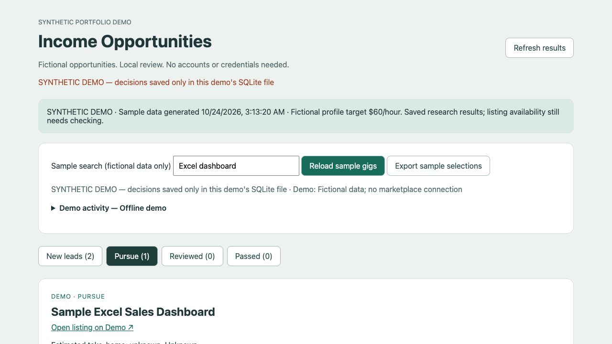

# Income Opportunities — local AI agent demo

A Python research and review app for freelance opportunities, with optional local Qwen evidence extraction. This public edition uses **fictional profiles and listings**. It needs no accounts, tokens, database server, or paid model.



## Runs on your own computer

Download and extract this repository or ZIP onto your own computer, then run the command below there. Python 3.10+ works on Windows, macOS and Linux (on Windows, use `py -3` instead of `python3` if needed). No connection to the author's computer or server is required or configured.

`127.0.0.1` means **the computer you are using**, not the author's computer. The demo listens only on that local address, so other computers cannot connect directly to it. There is no public hosting, remote tunnel or callback service. Sample data, review decisions and exports stay on your machine. Optional Qwen runs through your own local Ollama installation.

## Try it

Requires Python 3.10 or newer. No Python packages are needed to run the demo.

```sh
python3 demo.py --serve
```

Open <http://127.0.0.1:8876>. Review the three sample opportunities, choose **Pursue** or **Pass**, and export your sample selections. Decisions persist locally in `.demo/`. The sample links point to example.org and are not actual jobs. Stop the server with Ctrl+C.

For a report without the web interface:

```sh
python3 demo.py
```

For optional AI extraction, start your own local Ollama instance with `qwen3.5:4b` installed, then run:

```sh
python3 demo.py --qwen --serve
```

Only fictional listing text is sent to Ollama at loopback port 11434. The model extracts evidence; deterministic code ranks opportunities and validates exact source quotes. Missing or invalid model output falls back to rules. Reloading sample gigs in the interface uses rules only. The default demo does not call Ollama or external services.

## What the demo shows

- Three ranked opportunities, skill fit, budget information and earnings estimates.
- Evidence-backed explanations and explicit unknowns rather than invented pay or scope.
- Persistent local review decisions, with export of pursued items.
- A browser interface independent of ChatGPT.
- Testable boundaries for model output, source URLs, storage and submission approval.

The source also contains marketplace adapters, proposal and bid workflows, PostgreSQL/Excel integration, and a native macOS launcher from the broader application. **These are not configured or enabled by `demo.py`.** The demo rejects proposal generation, bid submission, SSH access and PostgreSQL use. Live integration modules are reference implementation code and can perform network or database operations if run separately and configured; this repository is not an operating-system sandbox.

Fee calculations are estimates, not promises of current platform terms. Fixed-price budgets are not hourly pay. All example budgets and qualifications are invented. This is a portfolio prototype, not an unattended bidding system.

## Tests and code style

```sh
python3 -m unittest discover -s tests
python3 -m pip install -r requirements-dev.txt
ruff check .
ruff format --check .
```

The tests use fixtures and mocks; they do not need real credentials or marketplace access. Optional frontend formatting uses the development dependency in `package.json`.

## Layout

| Area | Files |
| --- | --- |
| Safe demo entry point | `demo.py`, `fixtures/demo-*.json` |
| Ranking and orchestration | `ranking.py`, `workflow.py`, `domain.py`, `earnings.py` |
| Local model validation | `ollama_local.py` |
| Reviews and persistence | `review_store.py`, `file_store.py` |
| Browser interface | `dashboard.html`, `dashboard.js`, `mac_dashboard.py` |
| Integration reference code | `*_source.py`, `postgres_store.py`, `excel_feed.py`, `proposals.py`, `bids.py` |
| Regression coverage | `tests/` |

See [SANITIZATION.md](SANITIZATION.md) for the public-copy boundaries.

## License and responsibility

Released under the [MIT License](LICENSE.txt). You may use, modify, share and sell copies, including commercial services, subject to retaining the required copyright and permission notices. No separate commercial agreement or royalty is required under this license.

The software is supplied as is, without warranty. The license includes a limitation of liability for authors and copyright holders. These provisions operate subject to applicable law; no disclaimer guarantees immunity from every claim or overrides liability that cannot legally be excluded.

No employment, earnings, listing accuracy, security, service compatibility, maintenance or support is promised. Review outputs and any proposed external actions yourself. Use your own accounts and environment and follow the terms of external services. This repository provides no access to the author's computers or accounts.

The copyright notice uses the project's contributor designation to avoid publishing personal identity details. The license covers rights the contributors can grant; it does not assert exclusive copyright over unprotectable AI-generated material. Third-party components, models, data and services remain subject to their own terms.
